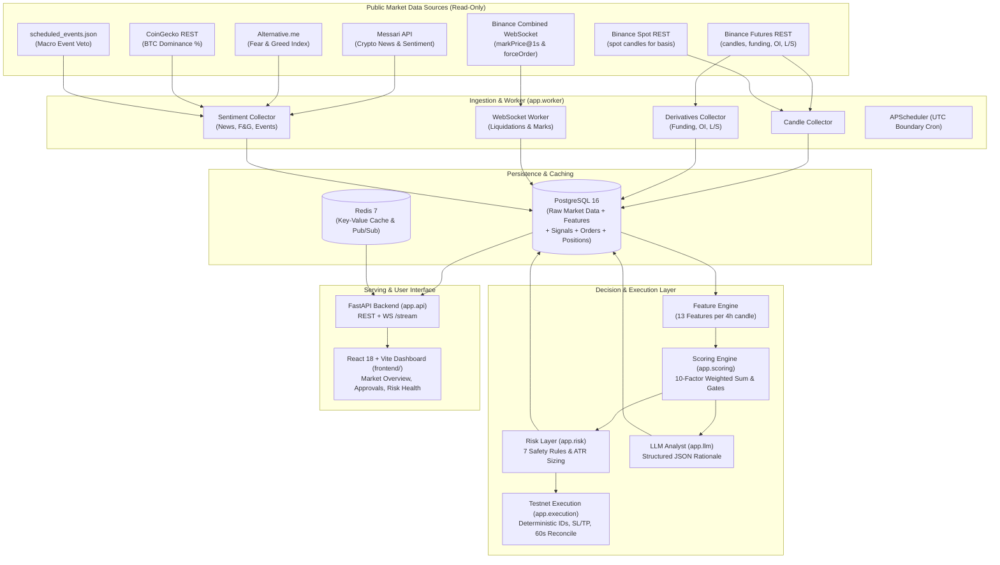

# TradeSphere Pro — Crypto Futures Data, Quantitative Signals & Risk Platform

TradeSphere Pro is an end-to-end quantitative trading and risk management platform for crypto perpetual futures. It continuously ingests real-time market data across multiple sources, computes 13 predictive and risk features without look-ahead bias, generates direction and confidence signals via a 10-factor weighted scoring engine, enforces strict mathematical risk constraints, explains signals using a provider-agnostic LLM analyst, serves a modern React + Vite dashboard, and executes orders exclusively on testnet environments with 60-second automated portfolio reconciliation.

---

## 1. System Architecture



---

## 2. Feature & Scoring Architecture

Every 4 hours (at `00:00`, `04:00`, `08:00`, `12:00`, `16:00`, `20:00` UTC + 60s), the engine evaluates 13 features for `BTCUSDT`, `ETHUSDT`, `SOLUSDT`, `BNBUSDT`, and `XRPUSDT`.

### The 10 Scored Fields (Normalized from -1.0 to +1.0)
| Field | Name | Weight | Core Logic |
|---|---|:---:|---|
| **F1** | Momentum | 12% | 14-day return skipping latest 24h, rolling 180d z-score squashed |
| **F2** | EMA Trend | 12% | `(EMA21 - EMA55) / ATR14`, dampened by slope divergence |
| **F3** | RSI + Divergence | 10% | Wilder RSI(14) with regular bullish/bearish swing divergence |
| **F4** | MACD | 10% | Histogram z-score + slope z-score |
| **F5** | Funding Trend | 9% | 4-day slope / 90d std, crowded trade penalty if `abs(rate) >= 0.05%` |
| **F6** | Open Interest Trend | 9% | 24h price direction vs 24h OI change matrix |
| **F7** | Long/Short Ratio | 8% | Retail contrarian score + top trader smart money booster |
| **F8** | Perp-Spot Basis | 8% | Basis slope normalised by 90d z-score |
| **F10** | Volume & S/R | 12% | 24h volume ratio + proximity to support/resistance |
| **F11** | News & Sentiment | 10% | Recency-weighted VADER sentiment + Fear & Greed index |

### Gate & Context Fields
- **F9 Liquidation Zones:** Identifies high-volume liquidation clusters. If a cluster lies on the adverse side between entry and nominal stop, the stop is moved beyond it by $0.25 \times ATR$. If resulting distance exceeds $3.0 \times ATR$, trade is rejected (`sl_too_wide`).
- **F12 Regime Filter:** Percentile rank of ATR and Bollinger width ($0.2$ to $1.0$). Scales confidence and position size.
- **F13 BTC Correlation:** Dampens non-BTC signals that oppose Bitcoin's primary trend when correlation $\ge 0.70$.
- **News Pause Gate:** Halts all new entries within $[T-30m, T+60m]$ of major scheduled macro events (CPI, FOMC).

---

## 3. Risk Management & Safety Constraints

The Risk Layer (`app.risk`) operates as an independent mathematical gate between signals and orders:
1. **Valid Prices & Orientation:** Strict checks ensuring $SL < Entry < TP$ for LONG and $TP < Entry < SL$ for SHORT.
2. **Dynamic ATR Sizing:** `risk_amount = equity * 1.0% * size_multiplier`; `qty = risk_amount / stop_distance`.
3. **Leverage Caps (Resize):** Maximum position leverage capped at 3x in config (hard capped at 5x in code). If required leverage exceeds the limit, quantity is resized down with an audit log.
4. **Total Portfolio Exposure:** Total margin used across all open positions cannot exceed 30% of equity.
5. **Drawdown Kill-Switch:** Daily loss $\ge 3.0\%$ or weekly loss $\ge 6.0\%$ automatically activates the global Kill-Switch, halting all new entries until manual review.
6. **One Position Per Symbol & Max 3 Open:** Prevents over-concentration in any single coin or the market at large.
7. **Cooldown After Loss:** Enforces a 3-candle cooldown before re-entering a symbol that suffered a losing trade.

---

## 4. Testnet Execution Engine (Section 9)

**TESTNET ONLY:** The execution engine (`app.execution`) refuses to start if `EXECUTION_MODE != "TESTNET"`. No live order adapter is present.

- **Deterministic Client Order IDs:** e.g. `tsp-{plan_id}-{symbol}-entry`, preventing duplicate orders across network retries.
- **Fail-Safe Protection Rule:** If an entry order fills but the subsequent Reduce-Only Stop-Loss order fails, the engine **immediately closes the position at market**, writes a `critical` risk event, and activates the Kill-Switch.
- **60-Second Automated Reconciliation:** Compares exchange balance, positions, and open orders with PostgreSQL every minute. Any unknown position on the exchange triggers an immediate emergency Kill-Switch.
- **Restart Recovery:** Recovers portfolio state from exchange API on startup before processing new orders.

---

## 5. Quickstart & Setup

### 1. Environment Configuration
Copy `.env.example` to `.env` and fill in your settings:
```bash
cp .env.example .env
```

Key environment variables:
```dotenv
POSTGRES_USER=tradesphere
POSTGRES_PASSWORD=your_password
POSTGRES_DB=tradesphere
DATABASE_URL=postgresql+psycopg://tradesphere:your_password@db:5432/tradesphere
REDIS_URL=redis://redis:6379/0

EXECUTION_MODE=TESTNET
LLM_PROVIDER=openai           # or anthropic, gemini, mock
LLM_API_KEY=your_key_here
BINANCE_TESTNET_API_KEY=your_testnet_key
BINANCE_TESTNET_SECRET=your_testnet_secret
```

### 2. Start the Backend Stack (Docker Compose)
```bash
docker compose up -d
docker compose ps
```
The stack spins up:
- `db`: PostgreSQL 16 on port 5432
- `redis`: Redis 7 on port 6379
- `api`: FastAPI on port 8000
- `worker`: APScheduler and Binance WebSocket runner

### 3. Start the Frontend Dashboard
```bash
cd frontend
npm install
npm run dev
```
Open [http://localhost:5173](http://localhost:5173) in your browser to view the interactive dashboard.

---

## 6. Running Tests & Audits

### Automated Test Suite
Run all 92 unit and integration tests across data, scoring, risk, LLM, API, and execution modules:
```bash
docker compose exec api pytest -q
# Output: 92 passed in ~7s
```

### Historical Backtesting
Run the historical backtest simulation engine with pessimistic stop-first resolution:
```bash
docker compose exec api python -m app.backtest.run --mode reduced --name "Full History Test"
```
Simulation reports are saved in `reports/` with metrics, equity curves, and baseline comparisons (Buy & Hold and 100 Random-Entry Seeds).

### Generate Signals On-Demand
```bash
docker compose exec api python -c "from app.signals.generator import process_features_into_signals; process_features_into_signals()"
```

---

## 7. API Reference

| Endpoint | Method | Description |
|---|---|---|
| `GET /health` | GET | Database and Redis connectivity health |
| `GET /market_overview` | GET | Real-time prices, 24h volumes, funding rates, and latest signals |
| `GET /signals` | GET | List recent signals with composite scores and confidence |
| `GET /signals/{id}` | GET | Detailed signal with 10-factor breakdown and AI explanation |
| `GET /plans` | GET | List proposed and approved trade plans |
| `POST /plans/{id}/approve` | POST | Manually approve trade proposal for testnet execution |
| `POST /plans/{id}/reject` | POST | Reject trade proposal |
| `GET /positions` | GET | Active exchange positions tracked via reconciliation |
| `GET /risk/status` | GET | Live portfolio margin used, daily drawdown, and Kill-Switch state |
| `POST /killswitch/trigger` | POST | Emergency trigger of Kill-Switch |
| `POST /killswitch/reset` | POST | Authorize reset of Kill-Switch |
| `GET /backtests` | GET | History of simulated backtest runs |
| `GET /backtests/{id}` | GET | Backtest run details, trade history, and baseline comparison |
| `WS /stream` | WS | Real-time WebSocket push for market updates, new signals, and risk events |
