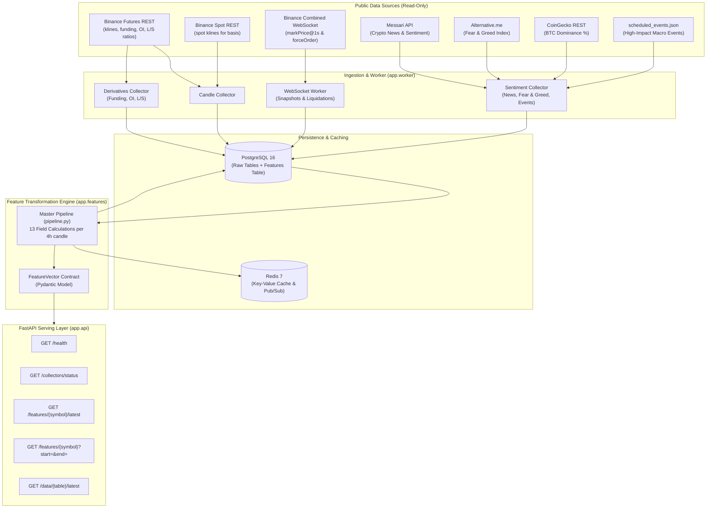

# TradeSphere Pro — Crypto Futures Data & Feature Pipeline

TradeSphere Pro is a real-time market data ingestion and quantitative feature engineering platform for crypto perpetual futures. It continuously collects raw market data across multiple sources, performs lookahead-free transformations, stores normalized records in PostgreSQL, caches real-time state in Redis, and exposes a clean contract for downstream scoring and risk algorithms.

---

## 1. System Architecture



---

## 2. The 13 Predictive Fields

Every 4 hours (at `00:00`, `04:00`, `08:00`, `12:00`, `16:00`, `20:00` UTC + 60s), the feature pipeline computes 13 standardized values for each active symbol (`BTCUSDT`, `ETHUSDT`, `SOLUSDT`, `BNBUSDT`, `XRPUSDT`).

### Scored Fields (Normalized from -1.0 to +1.0)
| Field | Name | Raw Source | Formula / Transformation Summary |
|---|---|---|---|
| **F1** | **Momentum** | Futures Candles | 14-day return skipping latest 24h: `close[t-6] / close[t-90] - 1`. Normalised via rolling 180-day z-score and squashed. |
| **F2** | **EMA Trend** | Futures Candles | `(EMA21 - EMA55) / ATR14`. Squashed to `[-1, 1]`. Halved by 0.5 if slope of EMA21 over last 3 bars disagrees with gap sign. |
| **F3** | **RSI + Divergence** | Futures Candles | Wilder RSI(14). Non-linear mapping (RSI 61 -> +0.22). Regular bullish (+0.3) or bearish (-0.3) divergence using swing points. |
| **F4** | **MACD** | Futures Candles | `0.6 * squash(z(hist / close)) + 0.4 * squash(z(slope / close))` with 180-day rolling z-score. |
| **F5** | **Funding Trend** | Funding Rates | Slope of last 12 funding points (4 days) divided by rolling 90-day slope std. Crowded trade penalty (0.5x) if `abs(rate) >= 0.05%`. |
| **F6** | **Open Interest Trend** | Open Interest | 24h price direction vs 24h OI value change matrix: Price UP / OI UP = `+1.0`, Price UP / OI DOWN = `+0.3`, Price DOWN / OI UP = `-1.0`, Price DOWN / OI DOWN = `-0.3`. Deadzone < 0.2% price or < 0.5% OI. |
| **F7** | **Long/Short Ratio** | Global & Top Trader Ratios | Retail global accounts contrarian score: `x = long_share - 0.5`. Deadzone 0.06, full scale 0.20. Smart money booster (+/- 0.2) if top position ratio opposes retail by > 0.05. |
| **F8** | **Perp-Spot Basis** | Futures & Spot Candles | `(futures_close - spot_close) / spot_close`. Rolling 18-bar slope normalised via 90-day z-score. |
| **F10** | **Volume & S/R** | Futures Candles | `0.6 * vol_component + 0.4 * sr_component`. `vol_component = sign(24h_return) * clip(vol_ratio - 1, 0, 1)`. `sr_component = +0.3` near support, `-0.3` near resistance. |
| **F11** | **News & Sentiment** | Messari, Fear & Greed | Exponential recency-weighted VADER sentiment on crypto headlines, blended with Fear & Greed index `(0.8 * news + 0.2 * fg)`. |

### Gate Fields (Filters & Position Multipliers — Not Scored)
| Field | Name | Role | Output / Behavior |
|---|---|---|---|
| **F9** | **Liquidation Zones** | Risk Filter | Nearest high-volume cluster of actual liquidated positions above and below price (bucket width `0.25 * ATR14`). Falls back to swing highs/lows (`swing_proxy`) if < 200 events in window. |
| **F12** | **Regime Filter** | Size Multiplier | Percentile rank average of ATR14 and Bollinger Band width over 90 days. Outputs `0.2` (choppy / low-volatility) to `1.0` (strong trending regime). Multiplies confidence / position size. |
| **F13** | **BTC Correlation & Dominance** | Market Gate | Rolling 30-day return correlation and beta against BTCUSDT, plus current BTC dominance % and BTC trend direction. Vetoes/dampens signals trading against strong BTC correlation. |
| — | **News Pause Gate** | Event Veto | Flagged `TRUE` if current candle falls in window `[T - 30min, T + 60min]` of any scheduled high-impact macro event (FOMC, CPI). Signals are blocked during news pauses. |

---

## 3. Database Schema

All database tables use PostgreSQL with idempotent upserts (`INSERT ... ON CONFLICT DO UPDATE`):

- **`candles`**: Open, High, Low, Close, Volume, Quote Volume, Trades, Taker Buy Base/Quote. Primary key: `(market, symbol, interval, open_time)`.
- **`funding_rates`**: 8-hour funding rates, mark price, and rate type. Primary key: `(symbol, funding_time)`.
- **`open_interest`**: 4h aggregate open interest and USD notional value. Primary key: `(symbol, period, ts)`.
- **`long_short_ratio`**: Global account, top trader account, and top position long/short ratios. Primary key: `(symbol, ratio_type, period, ts)`.
- **`premium_snapshots`**: 1-minute mark and index price snapshots from WebSocket. Primary key: `(symbol, ts)`.
- **`liquidations`**: Individual forced liquidation events from WebSocket. Unique on `(symbol, ts, side, price, quantity)`.
- **`news_items`**: Crypto headlines, publication time, currency, VADER compound score. Unique on `(source, external_id, currency)`.
- **`fear_greed`**: Daily Fear & Greed index value (0-100). Primary key: `ts`.
- **`btc_dominance`**: Daily / 30-min BTC market cap share %. Primary key: `ts`.
- **`scheduled_events`**: High-impact macro dates (FOMC, CPI). Unique on `(name, event_time)`.
- **`features`**: 13 computed features and gates per symbol per 4h candle. Primary key: `(symbol, interval, ts)`.
- **`collector_status`**: Heartbeat and health tracking for each collector. Primary key: `name`.

---

## 4. Setup and Quick Start

### 1. Configuration (`.env`)
Copy the environment template:
```bash
cp .env.example .env
```
Fill in your PostgreSQL password and external API keys:
```ini
POSTGRES_USER=tradesphere
POSTGRES_PASSWORD=your_password_here
POSTGRES_DB=tradesphere
DATABASE_URL=postgresql+psycopg://tradesphere:your_password_here@db:5432/tradesphere
REDIS_URL=redis://redis:6379/0
MESSARI_API_KEY=your_key_here
```

### 2. Run with Docker Compose
To launch all 4 services (PostgreSQL, Redis, FastAPI, Ingestion Worker):
```bash
docker compose up -d --build
```
Verify all containers are healthy:
```bash
docker compose ps
curl http://localhost:8000/health
```

### 3. Running Locally (Without Docker)
```bash
cd backend
pip install -r requirements.txt
uvicorn app.main:app --reload --port 8000
```

---

## 5. Running the Pipeline & Verification

### Running the Test Suite
```bash
cd backend
pytest -p no:cacheprovider -v
```
All unit tests, math validations, blueprint worked examples, and look-ahead bias checks run in under 2 seconds.

### Auditing Pipeline Quality & Data Continuity
Run the automated pipeline health audit:
```bash
cd backend
python -m scripts.check_pipeline
```
Outputs row counts, newest records, candle continuity verification (zero gap detection), and feature bounding checks across all tables.

### Independent Mathematical Verification (F2 & F3)
Verify EMA Trend and RSI calculations against an independent NumPy baseline on real Binance market data:
```bash
cd backend
python -m scripts.verify_f02_f03
```

---

## 6. Algorithm-Ready Output Contract

The downstream scoring engine and backtesting system read from the data pipeline exclusively through:

1. **`FeatureVector` Pydantic Model (`app.schemas.feature_vector`)**:
   ```python
   from app.features.pipeline import get_latest_features

   fv = get_latest_features("BTCUSDT", interval="4h")
   scores = fv.scored_fields()   # Dict of 10 normalized scores [-1, 1]
   gates = fv.gates()           # Dict of liquidation clusters, regime factor, news_pause
   ```

2. **Redis Real-Time Cache & Pub/Sub**:
   - Cache key: `features:latest:<SYMBOL>` (instant JSON serialization of newest candle features).
   - Channel: `features:updated` (publishes `{"symbol": "BTCUSDT", "ts": "..."}` on every 4h candle close).

3. **REST API Endpoints**:
   - `GET /health` — Liveness and readiness of database and Redis.
   - `GET /collectors/status` — Health status and row throughput for all ingestion jobs.
   - `GET /features/{symbol}/latest` — Returns newest `FeatureVector`.
   - `GET /features/{symbol}?start=...&end=...` — Historical features for backtesting.
   - `GET /data/{table}/latest?symbol=...` — Inspect raw market tables.

---

## 7. Known Limitations

1. **Historical Derivatives Limitation**: Binance public REST endpoints only provide roughly 30 days of historical Open Interest and Long/Short ratios. Older historical backtests before the pipeline launch date will have NULL for F6 and F7 (recorded in `missing`), whereas 2+ years of candles and funding rates are fully backfillable.
2. **Liquidation Clusters vs Theoretical Heatmaps**: F9 identifies clusters of **actual forced liquidations** recorded in real time from the WebSocket stream, not an exchange margin-level prediction heatmap. For periods with fewer than 200 recorded events, the algorithm safely falls back to local swing highs and lows (`swing_proxy`).
3. **News Sentiment History**: News APIs offer limited backfill depth. Old historical backtests will rely on Fear & Greed as the primary macro sentiment component.
